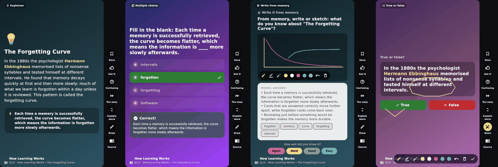
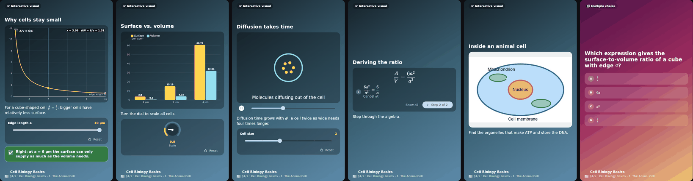
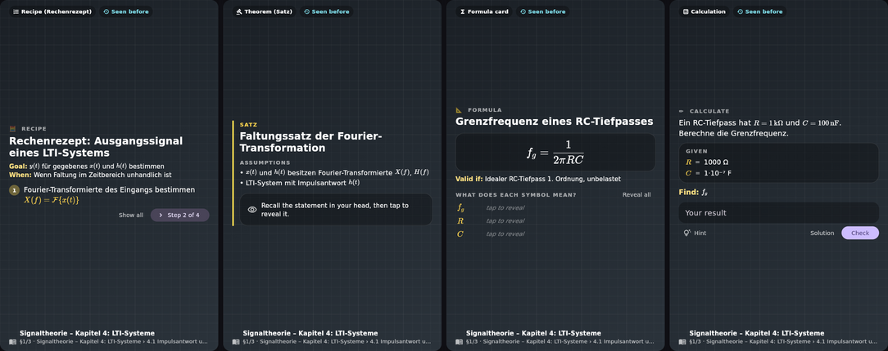
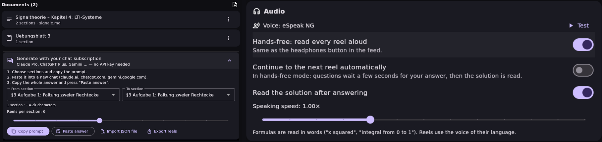

# UnRot

UnRot is a fully vibecoded short form content app that is intended to allow users to consume educational content
created for them by their AI models from study materials in short form interactive content.

Think TikTok/Instagram Reels, but every reel is a bite of **your own** study material: lecture scripts, books and
notes. Your own AI (bring your own API key, or your chat subscription via copy & paste) turns them into explainers,
quizzes, flashcards, gap texts, write-from-memory tasks, **math reels** (calculation recipes, theorems/Sätze,
formula cards, numeric exercises) and **interactive visuals** (graphs, charts, sketches, equations and figures with
sliders, dials and buttons). Reels can be **read aloud**. UnRot tracks your progress through the material and adapts
what it shows next.







## Features

* **Import study material**: PDF, EPUB, DOCX, Markdown, TXT, HTML, or pasted text. Material is split into sections
  following the document's headings (chapters, `1.2 …`, Markdown `#`). **Figures** (images) in PDF, EPUB and
  DOCX files are extracted with their captions and can be shown in reels.
* **Collections**: a source can hold several documents (script + exercise sheets + formula collection). Pick
  several files at once or use *Library → New collection*; add, reorder and remove documents in the source's
  *Documents* panel. Sections keep their document's name, so reels say where they come from.
* **Reel types**: explainer, key points, multiple choice, true/false, flashcard, fill-the-gap, memory hook
  (mnemonic), **write from memory** (handwrite/sketch with a pen, or type, then compare with a model answer) and
  **interactive visual**:
  * **graphs of functions** (`a*x^2 + b`, `e^(-t/S)`, …) with a tap/drag readout and points,
  * **charts** (bar, line, pie) whose values can depend on the controls,
  * **sketches/diagrams** drawn by the AI as SVG, which can be animated and driven by the controls,
  * **equations** derived step by step, and **figures** from your own material,
  * **controls**: sliders, dials (rotary knobs), toggles, option buttons and +/− steppers,
  * **animations** with play/pause/scrub, and **goals** ("make the parabola open downwards") that count as a
    correct answer when you reach them.
* **Math and science reels**:
  * **Calculation recipe** (*Rechenrezept*): a procedure revealed step by step, with formulas, a worked example
    and typical pitfalls.
  * **Theorem / law** (*Satz*, *Gesetz*, *Lemma*): exact assumptions, then recall the statement before revealing
    it; intuition, proof idea and example on tap.
  * **Formula card**: the formula plus a symbol legend (meaning and unit) to recall.
  * **Calculation exercise**: given values, type the result (`1,5e-3`, `2*pi*50`, `3·10^-5` all work), checked
    with a tolerance, with hint and step-by-step solution.
* **Subject profiles** for the TUM Electrical Engineering 3rd semester (*Analysis*, *Signaltheorie*,
  *Stochastische Signale*, *Festkörper-/Halbleiterbauelemente-Physik*, *Elektromagnetische Feldtheorie*) plus
  general math and physics. A profile tells the AI the course's notation and typical theorems/recipes and mixes the
  math reels into the feed. It is detected automatically on import and can be changed per source.
* **Math everywhere**: formulas written in LaTeX (`$\frac{a}{b}$`, `$$…$$`) are rendered in every reel type.
  Math-heavy reels get a calm **graph-paper background** (can be turned off).
* **Read aloud**: a *Listen* button on every reel, and a **hands-free** mode (headphones button) that reads each
  reel, waits a few seconds for your answer, reads the solution and can move on by itself. Formulas are spoken in
  words ("x squared", "Integral von 0 bis 1") in the reel's language. Uses the system voice on Android, iOS, macOS
  and Windows, and espeak-ng / speech-dispatcher on Linux.
* **Reel language per source**: keep reels in the material's language or have them translated (e.g. German
  script → English reels, with the original technical terms in brackets).
* **Study modes** per source:
  * **Linear course**: goes through the material in order; explains first, then checks understanding.
  * **Exam prep**: paces the material towards an exam date, focuses on exam-style questions and drills weak spots.
  * **Memorise (rote)**: flashcards and gap texts with spaced repetition until you know everything by heart.
  * **Explore / shuffle**: random bites from everywhere, favouring what you have seen least.
* **Progress tracking**: mastery per section, accuracy, streaks, weak spots, and spaced repetition (SM-2) that
  brings reviews back into the feed when they are due.
* **Adaptive generation**: the AI is told what you got wrong, what you found confusing ("Confusing" / "Too easy"
  buttons) and what it already covered. **Explain more** creates a deep dive on any reel.
* **Configurable feed**: share of the feed per source, reels per request, prefetching, share of reviews, mix of
  reel types (per study mode or custom), "study only this source/section".
* **Lower AI bills**: generated reels are saved and **shown again** after an interval (default 1 day, marked
  *Seen before*) before new ones are requested; a reel is **deleted after it was seen N times** (default 5; saved
  reels and ones you got wrong are kept). A **daily AI request limit** (default 40) makes the feed fall back to saved
  and offline reels.
* **Use your chat subscription** (Claude Pro/Max, ChatGPT Plus, Gemini …) without an API key: a source's *Generate
  with your chat subscription* panel copies a ready-made prompt for the chosen sections; paste it into the chat,
  copy the answer back and UnRot imports the reels (or import/export them as a JSON file).
* **Configurable generation**: difficulty (adaptive/easy/medium/hard), tone, default language, words per reel,
  emojis, amount of visuals (off/some/lots), web images on/off, custom instructions, and a focus note per source.
* **Bring your own AI**: Anthropic Claude, OpenAI, Google Gemini or any **OpenAI-compatible** endpoint
  (OpenRouter, Ollama, LM Studio, Groq, Mistral, DeepSeek, …). Includes "Browse models" and "Test connection".
  An **offline generator** works with no key or network. It can also show figures and plot formulas it finds in
  the text (e.g. `R(t) = e^(-t/S)` becomes a graph with a slider for `S`).
* **Pen support**: pressure-sensitive drawing, eraser (pen eraser end/button or tool), highlighter, palm rejection
  ("stylus only"), annotations directly on any reel, and handwriting in write-from-memory reels. Works with Apple
  Pencil, S Pen, USI, Windows Ink and Wacom.
* **Desktop-friendly**: mouse wheel and arrow keys / `J` `K` move between reels, Escape goes back, wide windows
  get a side navigation rail, and files passed on the command line are imported on start.




## Platforms

One Flutter code base for **Linux, Windows, macOS, iOS and Android**. This version is built and tested on
**Linux**. The other platform projects are generated and configured (permissions, entitlements, names) but still
need a first build on their host OS. See **[build-instructions/](build-instructions/)** for each platform:
[Linux](build-instructions/linux.md) · [Windows](build-instructions/windows.md) · [macOS](build-instructions/macos.md)
· [iOS](build-instructions/ios.md) · [Android](build-instructions/android.md).

## Quick start (Linux)

```bash
# prerequisites (Ubuntu/Debian): Flutter SDK ≥ 3.50 (see build-instructions/linux.md) plus
sudo apt install clang cmake ninja-build pkg-config libgtk-3-dev liblzma-dev libstdc++-12-dev
sudo apt install espeak-ng           # optional: voice for "read aloud"

git clone https://github.com/ChrisJu05/UnRot.git
cd UnRot/app
flutter pub get
flutter run -d linux                 # or: flutter build linux --release
```

Then click **Try with sample material** (or import your own files), and swipe or scroll through the feed.

## Using your AI subscription / API key

Open **Settings → AI provider**, choose a provider, paste your API key, optionally pick a model (**Browse** lists
the models your key can use) and press **Test connection**.

| Provider | Where to get a key | Default model |
|---|---|---|
| Anthropic Claude | platform.claude.com → API keys | `claude-opus-5-5` (choose `claude-sonnet-5-5` / `claude-haiku-5-5` for cheaper, faster reels) |
| OpenAI | platform.openai.com → API keys | `gpt-5-mini` |
| Google Gemini | aistudio.google.com → Get API key | `gemini-flash-latest` |
| OpenAI-compatible | your provider / local server (Ollama, LM Studio need no key) | set per server |

> **Note:** chat subscriptions such as Claude Pro/Max or ChatGPT Plus do **not** include API access. API keys are
> billed separately per use by the provider. Gemini has a free API tier, and local models via Ollama/LM Studio are
> free. Keys are stored only on your device (`secrets.json` in the app data folder) and sent only to the provider
> you selected.

### Without an API key: copy & paste with your chat subscription

1. Open a source in the **Library** and expand **Generate with your chat subscription**.
2. Choose the sections (the first sections without reels are preselected) and the number of reels per section,
   then press **Copy prompt**.
3. Paste the prompt into a new chat on claude.ai, chatgpt.com or gemini.google.com. For long material, do a few
   sections at a time.
4. Copy the whole answer and press **Paste answer** (the clipboard is filled in automatically), then **Import**.

The answer is a JSON block `{"unrot_reels": 1, "reels": [{"section": 3, "type": "quiz", …}]}`. **Export reels**
writes the same format, so reels can also be moved between devices or shared with fellow students.

### Keeping the AI bill low

*Settings → Feed → Saving AI costs* controls how soon seen reels come back (6 h … 1 week), after how many views a reel
is deleted, and *Settings → AI provider* sets the daily request limit (today's usage is shown next to it). Cheaper
models (e.g. `claude-haiku-5-5`) and more reels per request also reduce costs.

## Project layout

```
app/                    Flutter application (all platforms)
  lib/core/             models, JSON storage, secret store
  lib/modules/          ingestion · ai · generation · reels · visuals · study · feed · exchange · speech
  lib/ui/               screens, reel widgets, visuals (plots, charts, SVG, math, dials), pen canvas, theme
  lib/app/              composition root (AppServices) and MaterialApp
  test/                 unit + widget tests (145 tests) and fixtures
  linux/ windows/ macos/ ios/ android/   platform runners
build-instructions/     one build guide per platform
docs/ARCHITECTURE.md    how the pieces fit together and how to extend them
```

UnRot is built to be extended: new AI providers, reel types, study modes and import formats are each an interface
plus a registry entry. See [docs/ARCHITECTURE.md](docs/ARCHITECTURE.md).

## Development

```bash
cd app
flutter analyze        # static analysis (clean)
flutter test           # 145 unit and widget tests
```

Useful environment variables: `UNROT_DATA_DIR` (use another data folder), `UNROT_DISABLE_IMPELLER=1` (Linux:
use the Skia renderer, for VMs or software OpenGL).

## Roadmap ideas

* OCR for scanned PDFs, images and handwriting recognition for write-from-memory answers (AI vision grading)
* Send figures to vision-capable models so the AI can label and quiz on them (hotspots on images)
* 3D models and physics simulations as visual kinds
* AI-generated outlines for long books; whole-book exam simulations
* Platform keychains for API keys; sync between devices
* Natural cloud voices (e.g. OpenAI/ElevenLabs TTS) as additional speech engines
* Shared reel packs per lecture (import/export already uses a portable JSON format)

## License

GPL-3.0, see [LICENSE](LICENSE).
