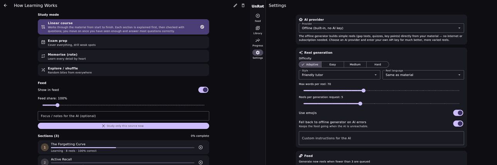

# UnRot

UnRot is a fully vibecoded short form content app that is intended to allow users to consume educational content
created for them by their AI models from study materials in short form interactive content.

Think TikTok/Instagram Reels, but every reel is a bite of **your own** study material: lecture scripts, books and
notes. Your own AI (bring your own API key) turns them into explainers, quizzes, flashcards, gap texts and
write-from-memory tasks. UnRot tracks your progress through the material and adapts what it shows next.


## Features

* **Import study material**: PDF, EPUB, DOCX, Markdown, TXT, HTML, or pasted text. Material is split into sections
  following the document's headings (chapters, `1.2 …`, Markdown `#`).
* **Reel types**: explainer, key points, multiple choice, true/false, flashcard, fill-the-gap, memory hook
  (mnemonic) and **write from memory** (handwrite/sketch with a pen, or type, then compare with a model answer).
* **Study modes** per source:
  * **Linear course**: goes through the material in order; explains first, then checks understanding.
  * **Exam prep**: paces the material towards an exam date, focuses on exam-style questions and drills weak spots.
  * **Memorise (rote)**: flashcards and gap texts with spaced repetition until you know everything by heart.
  * **Explore / shuffle**: random bites from everywhere, favouring what you have seen least.
* **Progress tracking**: mastery per section, accuracy, streaks, weak spots, and spaced repetition (SM-2) that
  brings reviews back into the feed when they are due.
* **Adaptive generation**: the AI is told what you got wrong, what you found confusing ("Confusing" / "Too easy"
  buttons) and what it already covered. **Explain more** creates a deep dive on any reel.
* **Configurable feed**: share of the feed per source, reels per request, prefetching, share of reviews, mix of
  reel types (per study mode or custom), "study only this source/section".
* **Configurable generation**: difficulty (adaptive/easy/medium/hard), tone, language, words per reel, emojis,
  custom instructions, and a focus note per source.
* **Bring your own AI**: Anthropic Claude, OpenAI, Google Gemini or any **OpenAI-compatible** endpoint
  (OpenRouter, Ollama, LM Studio, Groq, Mistral, DeepSeek, …). Includes "Browse models" and "Test connection".
  An **offline generator** works with no key or network.
* **Pen support**: pressure-sensitive drawing, eraser (pen eraser end/button or tool), highlighter, palm rejection
  ("stylus only"), annotations directly on any reel, and handwriting in write-from-memory reels. Works with Apple
  Pencil, S Pen, USI, Windows Ink and Wacom.
* **Desktop-friendly**: mouse wheel and arrow keys / `J` `K` move between reels, Escape goes back, wide windows
  get a side navigation rail, and files passed on the command line are imported on start.



## Platforms

One Flutter code base for **Linux, Windows, macOS, iOS and Android**. This version is built and tested on
**Linux**. The other platform projects are generated and configured (permissions, entitlements, names) but still
need a first build on their host OS. See **[build-instructions/](build-instructions/)** for each platform:
[Linux](build-instructions/linux.md) · [Windows](build-instructions/windows.md) · [macOS](build-instructions/macos.md)
· [iOS](build-instructions/ios.md) · [Android](build-instructions/android.md).

## Quick start (Linux)

```bash
# prerequisites (Ubuntu/Debian): Flutter SDK ≥ 3.50 (see build-instructions/linux.md) plus
sudo apt install clang cmake ninja-build pkg-config libgtk-3-dev liblzma-dev libstdc++-12-dev

git clone https://github.com/ChrisJu05/UnRot.git
cd UnRot/app
flutter pub get
flutter run -d linux                 # or: flutter build linux --release
```

Then click **Try with sample material** (or import your own files), and swipe or scroll through the feed.

## Using your AI subscription / API key

Open **Settings → AI provider**, choose a provider, paste your API key, optionally pick a model (**Browse** lists
the models your key can use) and press **Test connection**.

| Provider | Where to get a key | Default model |
|---|---|---|
| Anthropic Claude | platform.claude.com → API keys | `claude-opus-5-5` (choose `claude-sonnet-5-5` / `claude-haiku-5-5` for cheaper, faster reels) |
| OpenAI | platform.openai.com → API keys | `gpt-5-mini` |
| Google Gemini | aistudio.google.com → Get API key | `gemini-flash-latest` |
| OpenAI-compatible | your provider / local server (Ollama, LM Studio need no key) | set per server |

> **Note:** chat subscriptions such as Claude Pro/Max or ChatGPT Plus do **not** include API access. API keys are
> billed separately per use by the provider. Gemini has a free API tier, and local models via Ollama/LM Studio are
> free. Keys are stored only on your device (`secrets.json` in the app data folder) and sent only to the provider
> you selected.

## Project layout

```
app/                    Flutter application (all platforms)
  lib/core/             models, JSON storage, secret store
  lib/modules/          ingestion · ai · generation · reels · study · feed
  lib/ui/               screens, reel widgets, pen canvas, theme
  lib/app/              composition root (AppServices) and MaterialApp
  test/                 unit + widget tests (59 tests) and fixtures
  linux/ windows/ macos/ ios/ android/   platform runners
build-instructions/     one build guide per platform
docs/ARCHITECTURE.md    how the pieces fit together and how to extend them
```

UnRot is built to be extended: new AI providers, reel types, study modes and import formats are each an interface
plus a registry entry. See [docs/ARCHITECTURE.md](docs/ARCHITECTURE.md).

## Development

```bash
cd app
flutter analyze        # static analysis (clean)
flutter test           # 59 unit and widget tests
```

Useful environment variables: `UNROT_DATA_DIR` (use another data folder), `UNROT_DISABLE_IMPELLER=1` (Linux:
use the Skia renderer, for VMs or software OpenGL).

## Roadmap ideas

* OCR for scanned PDFs, images and handwriting recognition for write-from-memory answers (AI vision grading)
* Rendering formulas (LaTeX) and images/diagrams from the source in reels
* AI-generated outlines for long books; whole-book exam simulations
* Platform keychains for API keys; sync between devices
* Text-to-speech narration and auto-advancing "lean-back" mode

## License

GPL-3.0, see [LICENSE](LICENSE).
